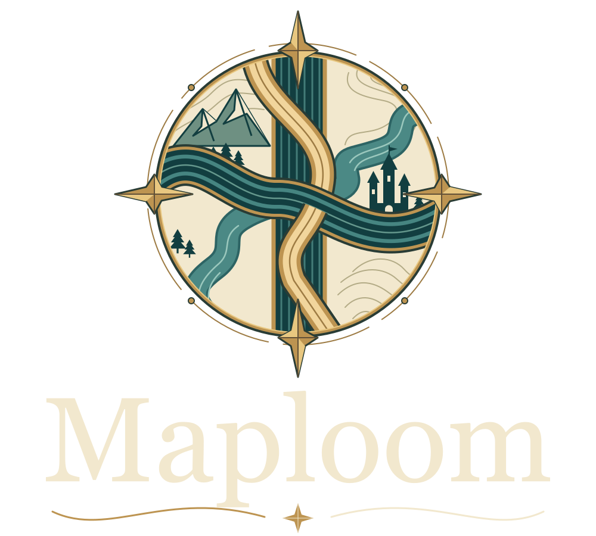
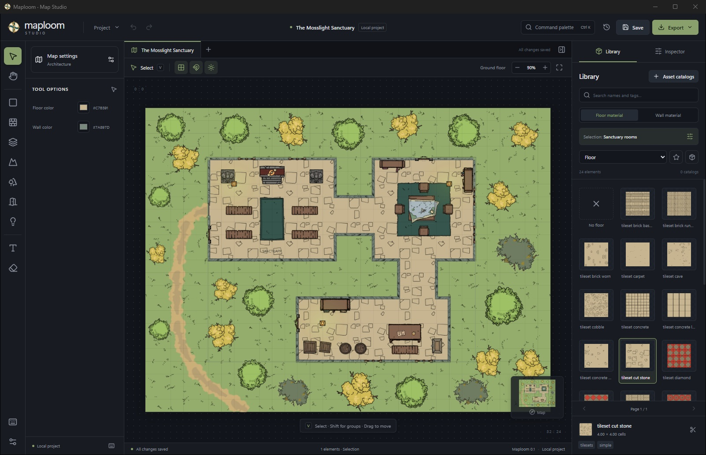

  

<strong>Where your next story becomes a map.</strong>

  A map editor for tabletop roleplaying games and virtual tabletops. 

  <a href="#make-your-first-map">Quick start</a> ·
  <a href="#installation">Installation</a> ·
  <a href="#documentation">Documentation</a>

## What is Maploom

Maploom is an open-source alternative to Dungeondraft that includes most of its features, as well as a number of unique
ones.

Maploom supports `.dungeondraft_map` and `.dungeondraft_pack` files to ensure compatibility.

## Make your first map

1. Open Maploom and create a map: choose a name and dimensions in grid cells. Select **Open sample** to explore an
   example.
2. Choose **Room**, then pick floor and wall materials in the library on the right. Drag on the map to draw a room.
3. Add doors, objects, terrain, and lights. Adjust selected elements in the inspector.
4. Save with `Ctrl+S`. When your map is ready, open **Export** and choose a level, format, and resolution.

To use your own packs, open **Asset catalogs**, add an asset folder, and enable the packs you want for the current map.
Use **Rescan directories** after adding files and **Locate directory** if a folder has moved.

## Installation

Packaging supports EXE/MSI installers and portable ZIPs for Windows, DMG and application archives for macOS, and DEB,
RPM, and AppImage for Linux. Choose a build for your operating system and processor.

For Windows portable builds, extract the entire archive and run `Maploom.exe`. The application requires WebView2
Runtime. Rendering the map requires hardware WebGL2 support and an up-to-date graphics driver.

To run from source, install Node.js 22.12+ or 24, Rust 1.88+, and the platform's desktop build dependencies, then run
`npm ci` and `npm run desktop` from the project root. Available build commands are listed
in [package.json](package.json).

## Your maps stay with you

Maploom works with files on your computer. A `.mloom` project keeps variations, levels, layers, and editable elements;
`.mloom_fabric` lets you create a portable asset library.

To save an object composition, select two or more objects on the map and choose **Create prefab** in the inspector.
Open **Objects → Prefabs** (the third object tool) to browse built-in compositions and **My prefabs**. Personal prefabs
are stored in a separate application library and are available across maps. Place a prefab with one click; its objects
keep their colors, transforms and draw order inside one combined map object. Clicking any part selects the whole
prefab. Move, rotate, scale, mirror, duplicate and delete apply to the entire composition; one undo removes the
placement. Objects from different layers are placed together on the active layer.

Use a prefab card's **Export prefab** button, or **Export list** for the filtered list. The resulting `.mloom_prefab`
contains the prefab definitions and every required image. Use **Import** in Prefabs to add them to your personal
library,
or connect the file through **Asset catalogs**. Original `.dungeondraft_prefab` files can also be imported when their
textures are available. The default pack includes all 15 original Dungeondraft example prefabs, including their objects,
paths and pattern shapes. Personal prefabs are stored separately in `prefabs.mloom_prefab` beside the application
settings.

In **Map settings**, select a variation from the dropdown. **+** copies the selected variation in full,
including its floors, layers, objects, background, and lighting. You can rename it or use **−** to remove it;
at least one variation always remains. Each variation has its own floors, and variation changes support undo and redo.

The export dialog has independent **Export all floors** and **Export all variations** options:

- Floors only: one ZIP containing the current variation's floors as `MapName-Floor.ext`.
- Variations only: one ZIP named after the map, containing each variation's main floor as `MapName-Variation.ext`.
- Both: choose a folder for separate ZIPs named after the map and each variation; floor filenames inside use
  `MapName-Floor-Variation.ext`.
- Neither: export the selected floor as a single file.

All exports use the same map canvas. The main floor includes the background; other exported floors are transparent.

Images in connected catalogs remain in those folders. When moving a map to another computer, bring the required assets
and use **Locate directory** in **Asset catalogs** to reconnect them. Created image variants and images embedded in
older projects remain inside the project file.

## Working with Dungeondraft

Open `.dungeondraft_map` files and connect unencrypted `.dungeondraft_pack` files. Import brings across supported
levels, geometry, objects, doors, lights, and labels. You can use your own asset libraries alongside DD packs.

Compatibility is still evolving: blend maps, caves, roofs, and some materials and autotiles are not fully reproduced.
Encrypted packs and writing maps back to Dungeondraft are not supported. SVG may differ from the on-screen image.

## Documentation

- [External themes](docs/themes.md) — user theme folders, CSS previews, and the isolated JS/TSX appearance API.
- [Theme preservation](docs/theme-lifecycle.md) — platform paths and installer/updater verification.
- [Localization](docs/localization.md) — JSON files to edit, adding a language, and the source files responsible for
  translation.

## Contributing

Help improve translations, documentation, or code. For translation work, start with the [language catalogs](locales/)
and [step-by-step guide](docs/localization.md).

When reporting a bug, include your operating system, Maploom version, reproduction steps, and map or pack format. Add a
screenshot and messages from **Activity**, if available.

## License

Maploom's source code is available under the [MIT license](LICENSE). Assets and images retain their authors' terms; the
code license does not change the rights to the default library or connected packs.
